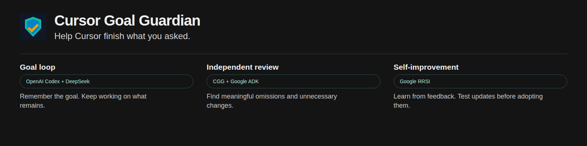
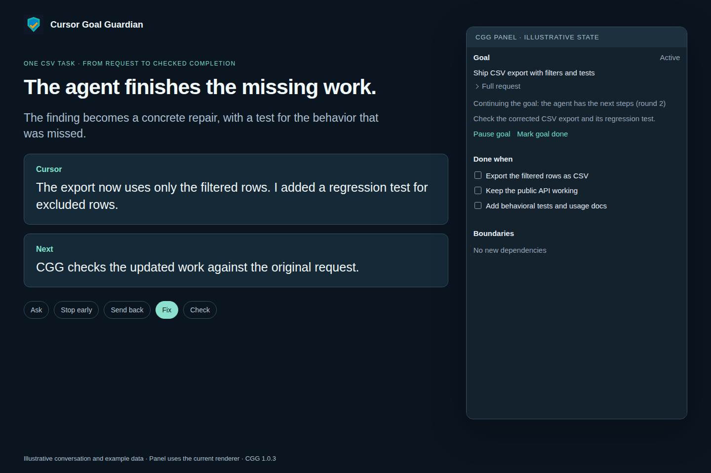

# Cursor Goal Guardian

**Keep Cursor working on your goal, check the finished work, and learn from your corrections.**

CGG helps an ordinary coding agent finish what you asked for. It remembers the goal across chats, sends the agent back when work remains, and gives completed work a separate review. It is not an honesty detector.



**Native package targets: Windows, macOS and Linux, on x64 and ARM64.** WSL projects use the Linux package. Real Cursor/model evidence comes from Linux/WSL; native package checks use a stand-in model. Linux builds require glibc 2.39+ and OpenSSL 3 (Ubuntu 24.04 or compatible).

## Three parts, one purpose

- **Goal loop.** Your request and finish conditions stay with the project. CGG brings prior work and checks back into context and sends the agent back with what remains. DeepSeek Harness supplies goal status, authority and round control; OpenAI Codex supplies usage accounting, optional token budgets and continuation instructions. Cursor remains the agent doing the work.
- **Independent review.** CGG's own reviewer checks the finished project for missing work, demonstrated bugs and meaningful unrequested changes. Google's open-source Agent Development Kit (ADK) separately evaluates the recorded work and supplied project evidence against your request. Useful findings go back to the agent; supporting tests, types and documentation are part of the work.
- **Learning from feedback.** Correct a specific review finding in the panel or in chat. The correction helps the current check and is saved for later learning. With enough examples, Google's RRSI tests reviewer-prompt updates on past work and checks them on examples withheld from search. CGG adopts an update only when it improves those feedback judgments without losing a confirmed useful finding. You can undo it.

These components have distinct jobs. CGG does not run Codex or DeepSeek as another implementation agent, use ADK to inspect files directly, or let RRSI change your goal or the fixed completion checks.

## Start using it

1. Install the **1.0.2 VSIX matching your extension host’s operating system and architecture** from [GitHub releases](https://github.com/khalidsaidi/cursor-goal-guardian/releases). The [Open VSX listing](https://open-vsx.org/extension/khalidsaidi/cursor-goal-guardian-extension) may lag: check its version and target before installing; older packages are not this release.
2. Open a trusted project folder in Cursor. Connect Guardian from its panel; the goal, finish conditions and boundaries are optional at setup.
3. Enable the project's **goal-guardian** MCP server in Cursor's settings when prompted.
4. Ask your agent for the work as you normally would. The request becomes the goal. Use `/guardian` for a short briefing or `/guardian-goal` to steer it.

Completion review uses Cursor CLI (`agent` or `cursor-agent`) signed in to your Cursor account. Each platform package bundles its other runtimes; it does not require a separate Google Cloud account or a Google model API key.



*Product illustrations use the current panel renderer with clearly labelled example data. They are not recordings of a real model run. See the [store guide](packages/cursor-goal-guardian-extension/README.md) for the full tour.*

## What happens while you work

The goal lives in `.cursor/goal-guardian/contract.json`, outside the agent's conversational memory. Questions alone do not create a goal. CGG captures requested project work, keeps the recorded request, and uses a detected list as the finish conditions. Only when the request supplies none may the agent add finish conditions.

The agent gets the goal, relevant previous checks and useful findings. Checks can be reused while the relevant project content and evidence stay unchanged. A new commit or a reworded completion report does not by itself require repeating them.

When the agent stops early, Cursor's desktop stop hook can send it back. Continuation is bounded by progress, round limits, user control and any goal token budget. A temporary instruction such as “only the first part for now” leaves the full goal for later.

When completion is requested, the project reviewer and ADK evaluator run. A disputed finding can receive a focused project check. Missing work goes back to the agent; unfinished verification gets a bounded recovery attempt. CGG does not ask the agent to prove its honesty, copy command output into a report or remove useful work to satisfy bookkeeping.

## You stay in control

Pause the goal, resume it, continue it in a new chat, or mark it done yourself. Your latest words are checked when the agent requests a goal change or pause. The agent cannot lift your pause on its own; you can resume from the panel or `/guardian-goal resume`.

The panel distinguishes an independently checked completion from incomplete checks, unresolved review findings, tracking failures, a block, a goal set aside for later, and work stopped by a limit. Internal records call a completion with passing checks `proved`; this describes the checks on that project state, not a guarantee about every possible input.

For learning, use **Goal Guardian: Command Center → Automatic learning…** to choose Off, Light or Standard. Feedback stays saved when learning is off. Background learning yields to active work, shares a rolling workspace allowance across attempts, and keeps the current reviewer when a candidate cannot qualify.

## Usage and privacy

Continuation, review, evaluator judgments and learning use your Cursor plan. A headless invocation can contain several model turns; invocation limits are not dollar or token caps. The reviewer and evaluator run on completion, rather than as extra implementation agents throughout the task. Automatic learning has its own configurable allowance.

Goal records, command output and replayable review cases are stored locally in the project's Guardian folder. Review and learning send relevant project content and records to the model through your Cursor account. Keep confidential material out of model-visible context as you would with Cursor itself.

## What the evidence supports

Real Cursor checks cover goal retention across chats, user control, review-driven repair and completion checks. Recent native reviews also show a specific correction removing an unnecessary complaint while a genuine missing public export remains caught. Earlier real-model RRSI search produced useful prompt changes; separate native checks verified installation of a qualified prompt and its use by a subsequent review.

Local tests cover the current integration, feedback handling, learning guards and usage controls. These are different kinds of evidence. They do not establish that every task will finish correctly, that every review finding is right, or that ordinary users' feedback has already improved reviewers in practice. A fresh full feedback → search → automatic adoption sequence has not completed in one native Cursor run.

See [verification](docs/verification.md), [performance and usage](docs/benchmarks.md) and the [maintainer release record](docs/release-status.md) for their precise scopes. No global improvement percentage or percentage of bundled source used is claimed.

## Limits

- CGG advises and sends follow-up messages; it cannot prevent the agent from stopping.
- Model reviews can be wrong, unavailable or inconclusive. Outside a Git repository the project review does not run, so completion cannot be independently checked by both checks.
- Desktop continuation needs Cursor's stop hook and a trusted workspace. The tested headless CLI does not supply that hook; CLI results do not demonstrate desktop continuation.
- Some ignored-path shell changes are not observed. Multiple stop hooks and Cursor changes can affect follow-ups.
- CGG does not protect its records against deliberate tampering. Its purpose is helping a normal agent finish the work.
- Native package checks exercise the goal loop, review, ADK and RRSI on each target with a stand-in model. Real Cursor/model evidence comes from Linux/WSL; these package checks do not measure model accuracy or desktop delivery on every OS.

## For contributors

Use Node.js and pnpm for development, plus Rust for the Codex goal wrapper. Build and check the parts you change:

```sh
pnpm install --frozen-lockfile
pnpm build
pnpm test
pnpm test:e2e:offline
pnpm package:vsix --target linux-x64
```

Repository layout: `packages/core` owns CGG's adapters and records; `hook` connects Cursor events; `mcp` exposes the six goal/feedback tools; `cursor-goal-guardian-extension` supplies the interface; `codex-goals`, `evaluator` and `rsi` connect the upstream components. See the [design](docs/goal-design.md) and [example workspace](examples/cursor-project/README.md).

Upstream code and legal notices are described in [NOTICE](NOTICE). CGG uses selected capabilities of [OpenAI Codex](https://github.com/openai/codex), [DeepSeek Harness](https://github.com/deepseek-ai/deepseek-harness), [Google ADK](https://github.com/google/adk-python) and [Google Research RRSI](https://github.com/google-research/rrsi).
