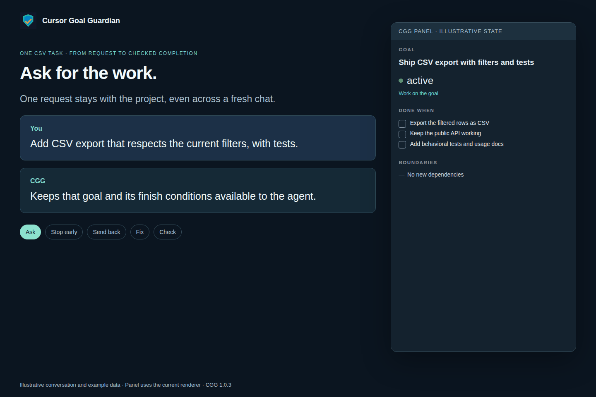
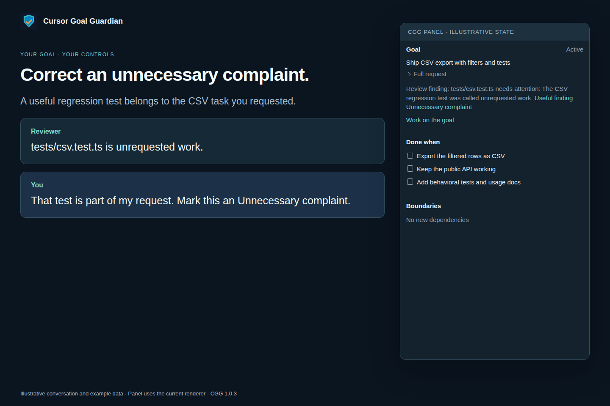

# Cursor Goal Guardian

**Keep Cursor working on your goal, check the finished work, and learn from your corrections.**

Ask your agent for the work as usual. CGG remembers the goal across chats, sends the agent back with unfinished work, and gives completion a separate check. It helps a normal agent finish; it is not an honesty detector.

**Native packages target Windows, macOS and Linux, on x64 and ARM64.** Choose the target of Cursor’s extension host; WSL projects use Linux. Real Cursor/model evidence is from Linux/WSL; native package checks use a stand-in model. Linux builds require glibc 2.39+ and OpenSSL 3 (Ubuntu 24.04 or compatible).

## What CGG adds

- **Goal loop:** your request, finish conditions and previous work stay available. DeepSeek Harness controls goal status and rounds; OpenAI Codex supplies accounting, optional token budgets and continuation instructions.
- **Independent review:** CGG's reviewer checks the actual project for missing work, real defects and meaningful unrequested changes. Google's open-source ADK separately evaluates the recorded work and project evidence against your request. Findings that need action go back to the agent.
- **Learning from feedback:** correct a specific finding in chat or the panel. Your reason helps the current review and is saved for Google's RRSI to test prompt updates when enough examples exist. An update must do better on withheld examples without losing confirmed useful findings. You can undo it.

*The visuals below are current product illustrations with example data. Panel views come from the production renderer. Chat, menus and guidance are explanatory illustrations, not recordings of real Cursor/model sessions.*

## Get started

1. Open a trusted project folder in Cursor and install the extension matching its host OS and architecture.
2. Open the Guardian panel and click **Connect Guardian**. You can fill the goal, finish conditions and boundaries now, or leave them empty.
3. Open Cursor's MCP settings and enable the project's **goal-guardian** server. Use **Open MCP Settings** if the connection notification is shown; remote workspaces may need this step opened manually.
4. Ask your agent for the work. CGG captures that request as the goal; a listed set of finish conditions becomes its checklist. Instructions after the list are retained.

Completion review needs Cursor CLI (`agent` or `cursor-agent`) installed and signed in to the Cursor account you want to use. The package bundles CGG's other runtimes. No separate Google Cloud account or Google model key is required.

## Stay with the goal

Use `/guardian` for a short account of the goal, what is complete and what remains. Use `/guardian-goal` to show or change the objective, pause it or resume it. A fresh chat keeps the recorded goal.

When you change direction, the new objective comes from your latest words. A temporary instruction such as “only the first part for now” leaves the rest of the goal for later.

The panel shows the goal and its finish conditions. **Pause goal** stops follow-ups; **Resume goal** or **Work on the goal** starts a new chat. You can mark work done yourself. The agent cannot resume your pause on its own.

## Finish useful work

On completion, the reviewer checks requested behavior, applicable tests/builds and affected public entry points. ADK checks the recorded work against your request. Supporting tests, types and documentation belong to the work; harmless formatting is not a reason to send the agent back unless you explicitly required it.

Valid checks can be reused while the relevant work and evidence are unchanged. A meaningful finding sends the agent back to finish the work. An incomplete check gets a bounded recovery attempt; if verification still cannot finish, CGG says so.

The panel distinguishes:

- **Complete:** the requested work passed the independent checks. The internal record calls this `proved`; it is not a guarantee about every possible input.
- **Unchecked:** work was reported complete, but an independent check did not finish.
- **Needs attention:** an unresolved review finding remains.
- **Unverified:** part of goal tracking could not run.
- **Blocked, set aside or stalled:** work needs help, was left for later, or stopped progressing.
- **Limit reached:** the continuation or goal usage allowance ended.

## Correct the reviewer

Use **Useful finding** or **Unnecessary complaint** beside a finding. Explicit chat judgments can reach the same records. If accepted work was unfinished, **This wasn't done** reopens the original goal. You do not need to rate every review or complete a separate reporting ritual.

In **Goal Guardian: Command Center → Automatic learning…**, choose Off, Light or Standard. Learning waits for enough specific feedback, yields to active work and shares a rolling workspace allowance. It tests reviewer-prompt changes; it does not change your goal or the evaluator. Feedback remains saved when learning is off, and **Undo** returns to the built-in reviewer.

Earlier real-model RRSI search produced useful prompt changes. Native Cursor checks cover corrections helping a current review and use of an installed candidate. Naturally accumulated user feedback has not yet demonstrated an improvement, and a fresh full feedback-to-search-to-adoption sequence has not completed in one native Cursor run.

## Usage and limits

Follow-ups, independent checks and learning use your Cursor plan. A headless invocation may contain several model turns; learning's invocation allowance is not a dollar or token cap. You control background learning from the Command Center.

CGG stores local goal records, command output and review cases under `.cursor/goal-guardian`. Relevant records and source are sent through your Cursor account for review and learning. Use the same care with confidential material as with Cursor itself.

CGG cannot force an agent to continue, guarantee a correct review or defend its records against deliberate tampering. Outside Git the project reviewer does not run. Desktop follow-ups require Cursor's stop hook and a trusted workspace; the tested headless CLI does not provide that continuation hook. Cursor updates and other stop hooks can affect the loop.

## Reference

Chat tools: `get_goal`, `create_goal`, `update_goal`, `goal_command`, `guardian_change_goal`, `guardian_review_feedback`.

CGG creates its goal/config/records under `.cursor/goal-guardian`, a rule under `.cursor/rules`, and the `/guardian` and `/guardian-goal` skills under `.cursor/skills`. Setup also registers a user-level goal-guardian MCP entry for agent-hub chats, preserving unrelated entries. Use **Goal Guardian: Remove from Workspace** to remove its project integration. The extension setting `goalGuardian.statusBar.enabled` controls the status-bar item.

See the [project README](https://github.com/khalidsaidi/cursor-goal-guardian#readme), [verification scope](https://github.com/khalidsaidi/cursor-goal-guardian/blob/main/docs/verification.md) and [design](https://github.com/khalidsaidi/cursor-goal-guardian/blob/main/docs/goal-design.md). Upstream contributions and licenses are recorded in NOTICE: [OpenAI Codex](https://github.com/openai/codex), [DeepSeek Harness](https://github.com/deepseek-ai/deepseek-harness), [Google ADK](https://github.com/google/adk-python) and [Google Research RRSI](https://github.com/google-research/rrsi).
