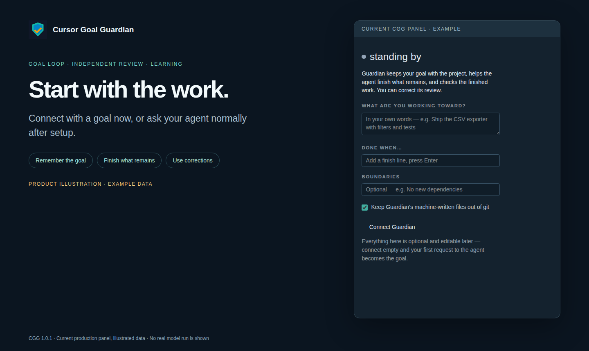
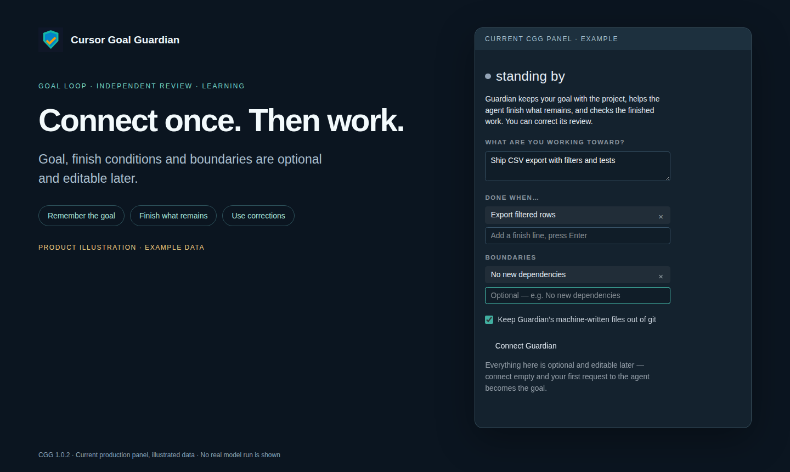
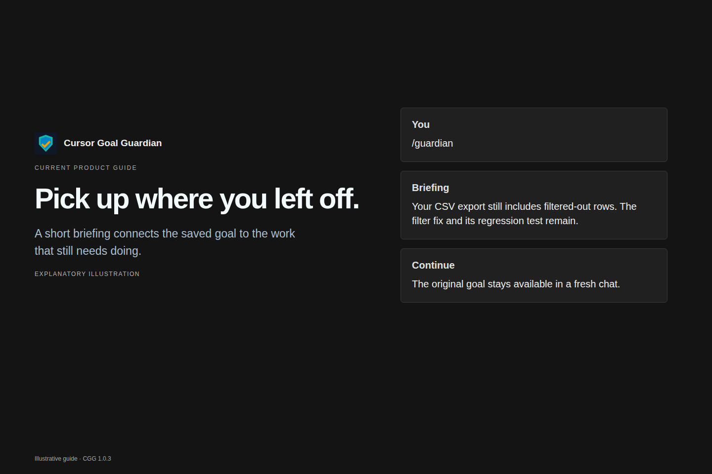

# Cursor Goal Guardian


**Your AI agent forgets what it's building. Guardian doesn't.**

Ask your agent for anything — Guardian quietly turns your request into a
tracked goal, watches the whole session, taps the agent on the shoulder when
it wanders, and shows you the story. It never blocks, and it never nags.


## What you get

- **A goal that can't get lost.** Your own request becomes the goal, with a
  "done when" checklist — kept outside the AI's memory, so compaction, resets,
  and long sessions can't erase it.
- **An agent that finishes.** When it stops early, Guardian sends it back with
  your goal and what's still open, until each item is backed by its record.
- **A reviewer that learns this project.** Mark each reviewer objection right or wrong.
  Once enough have a verdict, Guardian can try a better version of its reviewer, test it
  on your own past cases it didn't learn from, and offer it for you to apply or undo.
- **The story, whenever you want it.** "Where were we?" is a glance at the
  panel or a `/guardian` in chat — never an archaeology dig through history.

## Your first 10 minutes

You don't need to configure anything, learn any files, or read docs. Seven
steps, and step 5 is the whole trick.

**1. Install** from Open VSX (you're here). Guardian introduces itself
exactly once: its panel opens on its own the first time, then never
interrupts again. Nothing is written to your project yet.

**2. That open panel is home base.** It lives behind the target icon at the
top of the file sidebar — that's where you'll glance later. You'll see this:



**3. Fill the little form — or don't.** The whole setup is right there in
the panel: say what you're working toward in your own words, press Enter to
add each "done when" finish line (the × removes it), optionally add a boundary, and click **Connect Guardian**.
Every field is optional — connecting empty is fine, step 5 works either
way. No wizard, no separators, nothing to memorize. Guardian writes its
files into a small `.cursor/goal-guardian` folder you never need to open.



**4. One switch that belongs to Cursor.** On desktop, Cursor lists every
project-configured MCP server as *Disabled* until you enable it once —
that's Cursor's own safety rule, and Guardian walks you to it: a
notification appears with an **Open MCP Settings** button, the exact screen
opens, and you flip the switch next to your project's *goal-guardian* row.
Ten seconds, once per project. The panel's **Get started checklist** — it
ticks itself from what actually happens in your session, no "next" buttons —
is already keeping score.


**5. Ask your agent for something — like you always do.** That's the whole
trick. If you connected empty, your request *becomes* the goal: the agent
answers with one line — "Tracking: … — done when …" — writes its own
"done when" list, and gets to work. If you filled the form, the agent finds
your goal already on the record and starts on it instead. Either way: no
ceremony. And when a "done when" line says "with tests," the agent has to run
them before it can call that line proved.


**6. Glance at the panel** any time. Your goal is the title. The lamp and its word say
where the goal stands: active, paused, blocked, stalled, proved. The checklist ticks each "done when" line that a run
proved on Guardian's record.

**7. Type `/guardian` in the chat** and get a plain-language briefing of
where the session stands: what's proved and what's left.



That's it. You now have a session that can't lose the plot.

## The tour

### In your chat (where you already live)

Guardian's skills sit in the same `/` menu as everything else, and the agent
follows a session protocol automatically. Here is the whole core move — one
plain request, and the goal, the "Tracking:" line, and the "done when" list all
come from it:


And when *you* change direction ("actually, let's do X first"), the pivot
goes on the record — with its own done-when — instead of silently deleting
the old thread:


### The session panel

One glance answers "where does the goal stand?" — and every part of it is
labeled in plain words:


### One keystroke to steer

Click the status bar item (or run "Goal Guardian: Command Center") for direct
actions: update the goal, toggle how chatty notifications are, open Guardian's
files:


### The goal — done means proved

Most agents decide for themselves when they've finished. Guardian checks. When the
agent stops after editing files, it's sent back with your goal and what Guardian's
record shows, until one of these happens:

- **Proved.** For each "done when" line, the agent names a command it ran after its
  last edit and text that command printed, or a file and text in it. Guardian checks
  that against what it recorded itself. A command that never ran or failed, a result from
  before the latest change, or output that doesn't match is refused and the agent keeps working.
  The panel shows these receipts.
- **Blocked.** Something outside the agent's reach has stopped it, and it has tried for
  at least 3 turns.
- **Set aside.** Your latest message asked for only part of the goal or something else. The
  agent has to quote it, the goal stays open, and the next message is checked again.
- **Stalled or out of rounds.** Three rounds in a row where nothing changed, or 20 rounds
  for one message from you. The agent closes with what's done and what isn't, and the
  panel says it isn't proved, with rounds, time and tokens spent. An agent that never reports, usually because Guardian's MCP
  server is switched off, is left alone in that chat after it stalls once.

When the record backs every item, two independent checks run before "complete" is
accepted, both on your own Cursor model. A reviewer works in a throwaway copy of the
project and tries to prove each "done when" line isn't really done, and lists changes no
line needs. An evaluator reads Guardian's own record of the commands, their output and the
edits, and judges it against each of your "done when" lines and for work you didn't ask for.
Their objections go back to the agent like anything else that doesn't hold, at most twice
per run; after that the record decides and a standing objection is shown to you.

You're in charge from the panel. **Pause goal** stops the chat at work and the send-backs.
The agent can pause only by quoting your request to pause, and can never lift a pause. **Resume goal** and **Work on the goal** start the agent in a new
chat. **Mark goal done** closes a goal you're happy with, proved or not.

Every file the agent changed has to be tied to a "done when" line or called extra.
Extras are sent back once to undo. If the agent keeps one, it's listed in the panel for
you to decide. Only you change an existing goal: where Cursor reports your messages, the
agent has to quote your words to change it. If the agent edits Guardian's goal files, the
panel says so.

Works with any language or tool, because Guardian's own check only compares text and never
runs your project's commands. Each round is an agent turn on your Cursor plan, including one
short turn when you ask for something unrelated after the goal is set. The review at "done"
is one more agent call, and the evaluator five short ones; both are skipped, never
blocking, when `cursor-agent` isn't installed, the project isn't a git repository, or they
take too long.
In a git repository it also reads `git status` and `git diff`, so files changed by commands
count too. It keeps your last 3 messages and recent command output in the workspace's
Guardian folder, excluded from git.

**What it can't do:** it can't tell whether a command really tests what the agent says it
does (a script that just prints "passed" would get through), or whether a file the agent
tied to the goal was truly needed. The receipts are there so you can judge that. Outside
git, changes made by commands go unseen. It has been measured only on a test rig with a stand-in model,
not on a real Cursor model (the repository's README has the numbers and their limits). It doesn't run in
headless runs of the command-line agent, where Cursor fires no stop hook, or in Cmd+K, Ask or
Plan mode. Cursor only runs project hooks in a trusted workspace.

### Safety rails

- **Never blocks.** Every check answers "allow." Guardian never denies anything.
- **Never nags.** While the agent works, Guardian records and says nothing. It speaks at the end of a turn, about the goal.
- **Never surprises.** No popups except one migration notice. The status bar never turns red.
- **Leaves no trace.** "Remove from Workspace" deletes everything Guardian
  created — files, hook wiring, skills, the rule.

## Everything it does

| | Capability |
|---|---|
| **In chat** | ✓ Your request becomes the goal (with "done when" criteria) |
| | ✓ Agent loads the goal at every session start (survives resets) |
| | ✓ Only your own words change an existing goal |
| | ✓ `/guardian` briefing · `/guardian-goal` to declare/change the goal |
| | ✓ Three agent tools: `get_goal` and `update_goal` (Codex's own names and descriptions) and `guardian_change_goal` |
| | ✓ Works in Cursor's agent hub and the IDE — one-time connect approval |
| **Watching** | ✓ Every shell command, edit, and tool call observed (~60ms, invisible) |
| **The record** | ✓ One file holds the goal; an append-only tape holds what happened |
| **IDE** | ✓ Full-height session panel (goal, lamp, checklist) |
| | ✓ Setup is a form in the panel — type, press Enter, Connect; no wizard, no separators |
| | ✓ Introduces itself once: the panel opens on its own after install |
| | ✓ One-click "Open MCP Settings" guidance for Cursor's per-project enable |
| | ✓ Get-started tour that completes from the real session, not from clicks |
| | ✓ Click-to-edit goal |
| | ✓ Status bar with click-to-steer Command Center |
| | ✓ 8 palette commands incl. guided setup and full uninstall |
| **Trust** | ✓ Advisory forever — never blocks |
| | ✓ Automatic migration from 0.4.x with backups |
| | ✓ Ships as self-contained native builds for all six platforms (Linux, macOS, Windows × x64/arm64) — no Node.js required |
| | ✓ 200+ tests incl. real-agent end-to-end suites and live-editor verification |

## How it works (plain English)

Drift happens because "what we're working on" normally lives in the AI's
head, and the AI's head leaks. Guardian writes the goal down as a **fact in a
file**:

1. **One answer to "what is the goal?"** The hooks, the panel and the agent all
   read the same file. Only your own words change an existing goal.
2. **It comes back with every message.** A new chat or a compacted one still has
   the goal in front of it.
3. **The agent can't just stop.** When it stops after editing files it's sent back
   until its report holds against Guardian's own record of what ran.
4. **A tape of what happened.** Every shell command, edit and tool call is recorded,
   so you can see what the session did.

## Reference

**Files** (created by Connect, removed by uninstall — you never need to open
them):

```
.cursor/goal-guardian/
  contract.json      # the goal and "done when" list
  config.json        # settings version
  telemetry/         # the tape (gitignored)
.cursor/rules/goal-guardian.mdc      # teaches the agent the protocol
.cursor/skills/guardian*/            # /guardian and /guardian-goal
```

**Settings**: `goalGuardian.statusBar.enabled`.

## Upgrading from 0.4.x

Automatic on first activation: files backed up as `*.v1.bak`, one passive
notice, done. The old permit system and task board are retired; your
goal carries over.

## Validation

200+ unit and contract tests (quietness contract, hook latency budget,
migration goldens from real 0.4.x workspaces), an end-to-end suite
driving **real** Cursor agents — including an uninstructed agent cooperating
purely from the session rule — live-editor verification down to the rendered panel, and a
six-architecture CI matrix that compiles and *executes* the shipped binaries
on Linux, macOS, and Windows, x64 and arm64 alike.

## Credits

Guardian stands on other people's work and uses it as it is, unmodified; see `NOTICE`.

- The goal loop's instructions to the agent are those of [OpenAI Codex](https://github.com/openai/codex)'s
  goal extension (Apache-2.0) and [DeepSeek Harness](https://github.com/deepseek-ai/deepseek-harness)'s goal
  packages (MIT), word for word.
- The evaluator is [Google's Agent Development Kit](https://github.com/google/adk-python) (Apache-2.0).
- The reviewer improves itself with [RRSI](https://github.com/google-research/rrsi) by Google Research
  (Apache-2.0).

