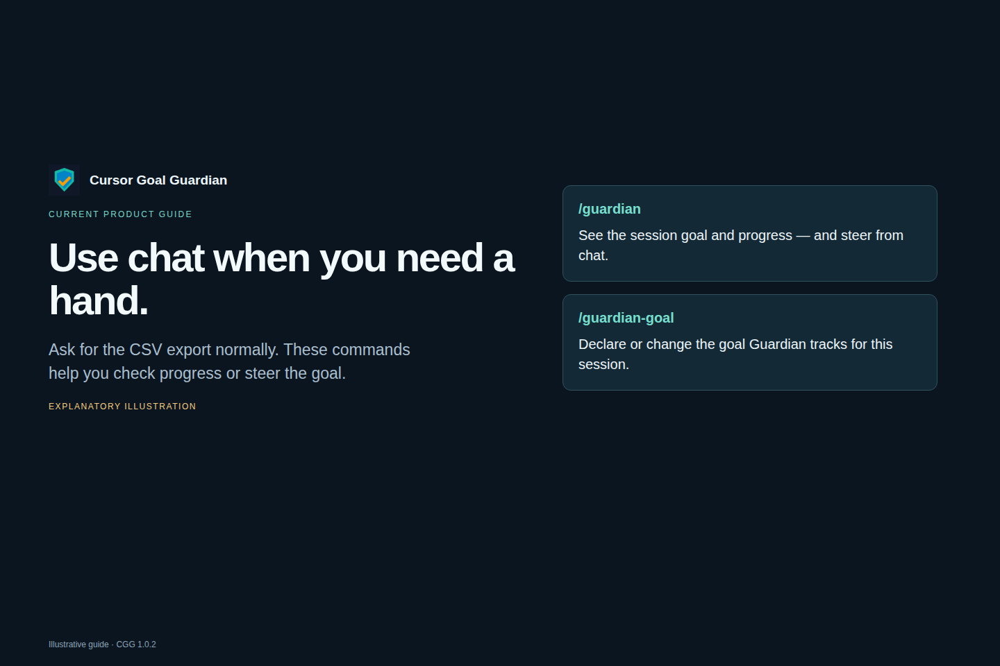
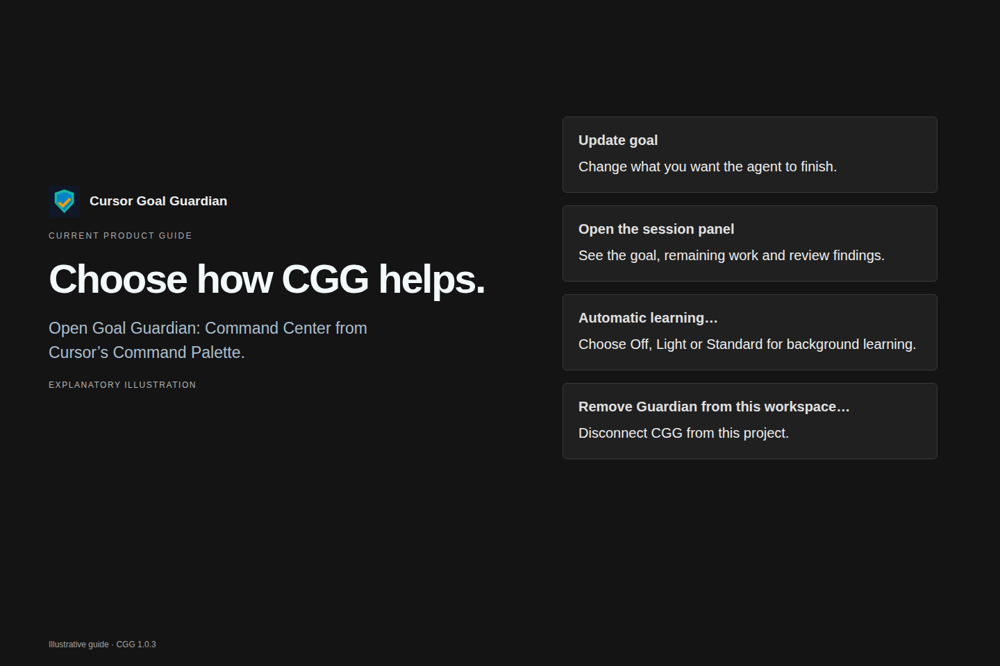

# Cursor Goal Guardian


**Your request becomes the goal, the agent is reminded of it, and it is sent back when it stops early.**

Ask your agent for something the way you always do. Guardian records that request as the
goal, puts it in front of the agent with every message, and when the agent stops before the
goal is accepted, sends it back with what is still open. When the agent says it is done,
the work is checked before that is accepted. It never blocks: the agent can always stop,
and Guardian shows you how the goal stood when it did.


*The screenshots on this page are from an earlier version. The panel's layout is the same;
some of its words have changed.*

## What you get

- **A goal that stays put.** Your own request becomes the goal, with a "done when"
  checklist, kept in a file outside the AI's memory, so a new chat or a compacted one still
  has it.
- **An agent that is sent back.** When it stops early, Guardian sends it back with your
  goal and what's still open.
- **"Done" is checked.** CGG uses its captured command results and actual project changes.
  A second agent reviews the finished work and an evaluator checks it against your goal. The panel says whether the goal ended proved, unchecked or disputed.
- **A reviewer you can correct.** Mark each objection right or wrong, or say "this wasn't
  done" when it missed something. Once there are enough verdicts Guardian tries a better
  version of its reviewer by itself, keeps it only if it does better on your past cases it
  didn't learn from, and shows an Undo. This has never run on real feedback: it has only
  been tried on constructed cases, so whether it improves anything for you is unproven.
- **Where things stand.** A glance at the panel, or `/guardian` in chat.

## Your first 10 minutes

Seven steps. Step 5 is the whole of it.

**1. Install.** The panel opens on its own the first time, then never interrupts again.
Nothing is written to your project yet.

**2. That open panel is home base.** It lives behind the target icon at the top of the
file sidebar.


**3. Fill the form, or don't.** Say what you're working toward in your own words, press
Enter to add each "done when" line (the × removes it), optionally add a boundary, and click
**Connect Guardian**. Every field is optional. Guardian writes its files into a
`.cursor/goal-guardian` folder.


**4. One switch that belongs to Cursor.** Cursor lists every project-configured MCP server
as *Disabled* until you enable it once. A notification appears with an **Open MCP
Settings** button; flip the switch next to your project's *goal-guardian* row. Once per
project. The panel's **Get started checklist** ticks itself from what happens in your
session.


**5. Ask your agent for something, like you always do.** If you connected empty, Guardian
records your request in your own words as the goal when the agent starts project work,
with automatic capture on the first change as a fallback:
the full request is kept as the goal, and a detected list also supplies the "done when"
items. Instructions after the list are retained. If you filled the form, that goal is
already on the record.


**6. Glance at the panel** any time. Your goal is the title. The lamp and its word say
where the goal stands: active, paused, blocked, stalled, proved, unchecked, disputed,
unverified. The checklist ticks the requested items established by the completed checks.

**7. Type `/guardian` in the chat** for a short briefing of where the goal stands.


## The tour

### In your chat

Guardian's skills sit in the same `/` menu as everything else. One plain request, and the
goal and its "done when" list come from it:


When you change direction ("actually, let's do X first"), your new words become the goal:




### The session panel


### The Command Center

Click the status bar item (or run "Goal Guardian: Command Center") to update the goal, open
the panel, open one of Guardian's files, or remove Guardian from the workspace:



### How a goal ends

When the agent stops after changing something, CGG keeps your goal in the loop. Completion
is checked using the command results and project changes CGG already recorded. The agent
does not have to copy output quotes, relabel every file or undo harmless formatting to
satisfy bookkeeping. Missing requested work, real bugs, broken tests/builds and meaningful
unrelated changes go back to the agent. Supporting types, tests and docs stay unless you
explicitly required otherwise. Valid checks are reused while the relevant work and evidence
remain unchanged.

The reviewer must report build, public API and focused behavior checks with evidence.
An unresolved failed check prevents proved. An absent or inconclusive check first sends
the agent back to finish local verification and retry unfinished checks once. If a check
still cannot finish, the work ends unchecked.
Supporting type declarations are part of the requested work. If the reviewer alone calls
them extra while the evaluator disagrees, a fresh project check can dismiss that objection
without forcing a change to completed work.

When completion is requested, two checks run on your own Cursor model. A reviewer works
in a throwaway copy of your project, checks the requested behavior, and identifies
unfinished work, demonstrated defects and meaningful unrelated changes. An evaluator judges Guardian's record of the run against each line
and for work you didn't ask for; when the two disagree, a fresh check verifies the disputed claim
against the project first. Objections go back to the agent.

The panel then shows one of:

- **Proved.** Both checks established the requested work and neither objected.
- **Unchecked.** A check didn't run or didn't answer for a requested item: for
  example `cursor-agent` isn't installed, the project isn't a git repository, or it took
  too long.
- **Disputed.** A check objected and it wasn't resolved. Reporting the same work again
  doesn't get a new review.
- **Unverified.** Part of Guardian couldn't run, so the goal was neither kept going nor
  accepted.
- **Blocked.** The agent reported an obstacle outside its reach. If it did so on the first
  turn, the panel says "blocked (unverified)": that was accepted at the agent's word.
- **Set aside.** Your latest message asked for only part of the goal or for something else.
  The agent has to quote it; the goal stays open.
- **Stalled or out of rounds.** Three rounds in a row where nothing changed, or 20
  send-backs for one message from you.

You're in charge from the panel. **Pause goal** stops the chat at work and the send-backs;
the agent can pause only by quoting your request to pause from your latest message, and can
never lift a pause. You lift it from the panel, or by sending `/goal resume`. **Resume goal** and **Work on the goal** start the agent in a new chat.
**Mark goal done** closes a goal you're happy with.

File labels are optional hints; the checks examine actual changes for meaningful unrelated work. Only
your words change the goal: the agent has to quote your latest message to change it, and if
it rewrites Guardian's goal file, the file is put back. One exception: when your goal has no
"done when" lines at all, the agent may write them; once there are any, it can't add more.

**What it costs.** Each send-back is an agent turn on your Cursor plan. A review is one
more agent call for the reviewer, one evaluator sample by default, and one more
when the two checkers disagree. On Linux, the moment the agent stops and is sent back
takes about 0.55 seconds of Guardian's own time, and a message of yours about 0.16. The
download is 171 MB and unpacks to 440 MB.

**What it can't do.**
- It never blocks. The agent can stop anyway.
- It can't tell whether a command really tests what the agent says; the reviewer is the
  check on that.
- It doesn't defend its own files: an agent that tampers with Guardian's records under
  `.cursor/goal-guardian` can end up "proved".
- Questions alone do not start a goal. A newly started implementation or repair can be
  continued before its first edit. Shell-only changes in ignored paths are not seen.
  Outside git, the reviewer doesn't run, so nothing ends proved.
- Automatic continuation needs Cursor's stop hook. The tested headless CLI delivered
  goal-tool and file events but no stop hook; those checks do not validate desktop
  continuation. Cmd+K, Ask and Plan modes do not continue the goal. Project hooks need a
  trusted workspace.
- Performance studies use a Linux test rig with a stand-in model. A desktop smoke test
  with Grok 4.7 Medium and WSL Ubuntu also passed the stop, fresh-chat resume and completion
  review workflow. Builds and runs remain limited to Linux x64. The repository's README
  describes the evidence and its limits.

### Safety rails

- **Never blocks.** Every check answers "allow."
- **Quiet while the agent works.** Guardian records and says nothing. It speaks when the
  agent stops, about the goal.
- **Few popups.** A notice on connecting that points you to Cursor's MCP settings, a
  confirmation before "Remove from Workspace", and one migration notice.
- **Leaves no trace.** "Remove from Workspace" deletes everything Guardian created: files,
  hook wiring, skills, the rule.

## How it works

1. **One answer to "what is the goal?"** The hooks, the panel and the agent all read the
   same file. Your own words change it; the agent writes "done when" lines only when the
   goal has none.
2. **It comes back with every message.** A new chat or a compacted one still has the goal
   in front of it.
3. **The agent is sent back.** When it stops with the goal not accepted, Cursor's stop
   hook returns a message that puts it back to work, up to 20 times per message of yours.
4. **A record of what happened.** Every shell command with its output and every edit is
   recorded in your workspace, excluded from git, along with your last 3 messages.

## Reference

**Files** (created by Connect, removed by uninstall):

```
.cursor/goal-guardian/
  contract.json      # the goal and "done when" list
  config.json        # settings version
  telemetry/         # the record of commands, edits and outcomes (gitignored)
.cursor/rules/goal-guardian.mdc      # teaches the agent the protocol
.cursor/skills/guardian*/            # /guardian and /guardian-goal
```

**Agent tools**: `get_goal`, `create_goal`, `update_goal`, `goal_command`,
`guardian_change_goal`.

**Settings**: `goalGuardian.statusBar.enabled`.

## Upgrading from 0.4.x

Automatic on first activation: files backed up as `*.v1.bak`, one passive notice. The old
permit system and task board are retired; your goal carries over.

## Credits

Guardian runs other people's code beside its own, as they wrote it; see `NOTICE` for what
runs and what is adapted.

- [OpenAI Codex](https://github.com/openai/codex)'s goal package (Apache-2.0) and
  [DeepSeek Harness](https://github.com/deepseek-ai/deepseek-harness)'s goal packages (MIT)
  supply complementary goal support: DeepSeek owns goal status, authority checks and
  rounds; Codex supplies usage budgets and continuation instructions. Status changes
  notify Codex without a second approval. Both supply instructions the agent is sent.
- The evaluator is [Google's Agent Development Kit](https://github.com/google/adk-python)
  (Apache-2.0).
- The reviewer's prompt is retuned with [RRSI](https://github.com/google-research/rrsi) by
  Google Research (Apache-2.0).

Automatic learning yields to active work and shares a rolling workspace allowance across attempts. In **Goal Guardian → Automatic learning…**, choose Off, Light or Standard. Feedback remains saved when learning is off. Compatible checks and search history are reused; learning is evaluated against the specific findings you judged.

Explicit chat corrections to identified review findings can feed the same learning records as the panel buttons. Vague remarks and the agent's own disagreement do not supply learning labels. The current check receives your reason; later learning preserves observed useful catches during search and checks candidates on held-out work before adoption.
