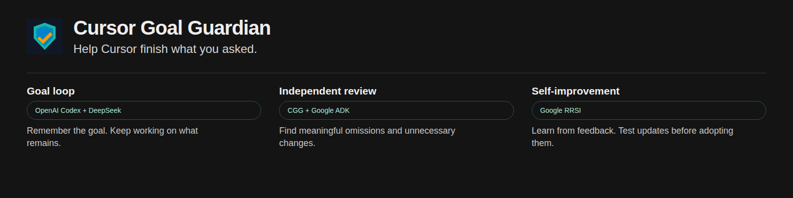
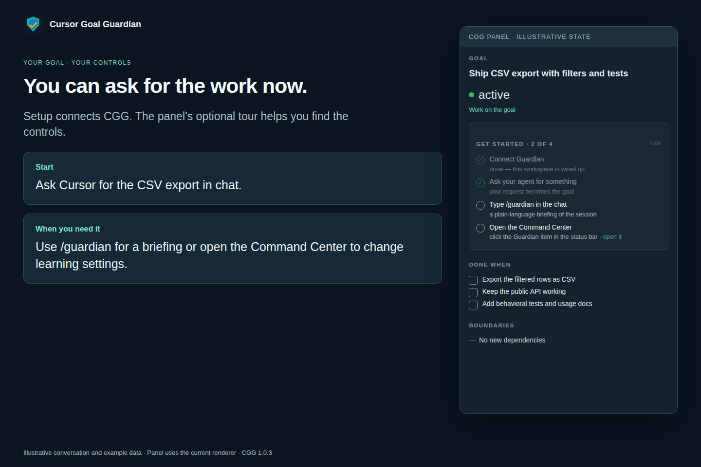
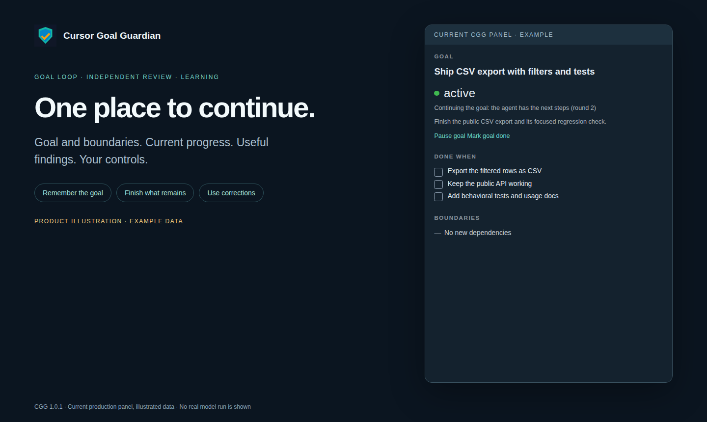
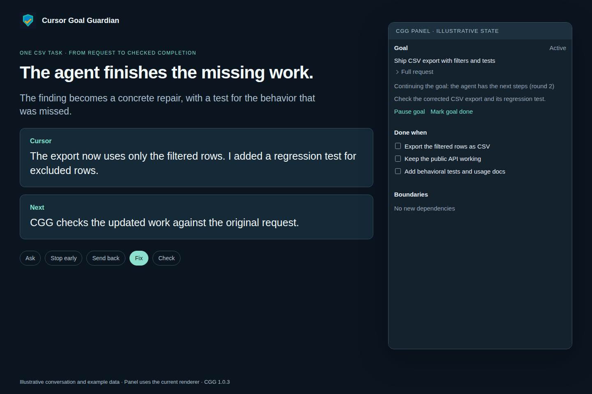

# Cursor Goal Guardian



**Your AI agent forgets what it's building. Guardian doesn't.**

Ask your agent for anything — Guardian quietly turns your request into a
tracked goal, watches the whole session, taps the agent on the shoulder when
it wanders, and shows you the story. It never blocks, and it never nags.


## What you get

- **A goal that can't get lost.** Your own request becomes the goal, with a
  "done when" checklist — kept outside the AI's memory, so compaction, resets,
  and long sessions can't erase it.
- **A second pair of eyes on every session.** Every command, edit, and tool
  call is checked against the goal. Real detours get one calm sentence in
  chat; false alarms get cleared by an AI reviewer — with reasons.
- **The story, whenever you want it.** "Where were we?" is a glance at the
  panel or a `/guardian` in chat — never an archaeology dig through history.

## Your first 10 minutes

You don't need to configure anything, learn any files, or read docs. Seven
steps, and step 5 is the whole trick.

**1. Install** from Open VSX (you're here). Guardian introduces itself
exactly once: its panel opens on its own the first time, then never
interrupts again. Nothing is written to your project yet.

**2. That open panel is home base.** It lives behind the target icon at the
top of the file sidebar — that's where you'll glance later. You'll see this:


**3. Fill the little form — or don't.** The whole setup is right there in
the panel: say what you're working toward in your own words, press Enter to
add each "done when" finish line (each becomes a task on the board, the ×
removes it), optionally add a boundary, and click **Connect Guardian**.
Every field is optional — connecting empty is fine, step 5 works either
way. No wizard, no separators, nothing to memorize. Guardian writes its
files into a small `.cursor/goal-guardian` folder you never need to open.


**4. One switch that belongs to Cursor.** On desktop, Cursor lists every
project-configured MCP server as *Disabled* until you enable it once —
that's Cursor's own safety rule, and Guardian walks you to it: a
notification appears with an **Open MCP Settings** button, the exact screen
opens, and you flip the switch next to your project's *goal-guardian* row.
Ten seconds, once per project. The panel's **Get started checklist** — it
ticks itself from what actually happens in your session, no "next" buttons —
is already keeping score.



**5. Ask your agent for something — like you always do.** That's the whole
trick. If you connected empty, your request *becomes* the goal: the agent
answers with one line — "Tracking: … — done when …" — writes its own
"done when" list, and gets to work. If you filled the form, the agent finds
your goal already on the record and starts moving the board instead. Either
way: no ceremony. And when a task says "with tests," the agent runs them
before the box gets ticked — **done means verified**, and if something on
your machine blocks the proof, the agent says so plainly and offers to fix
it or record the gap. Your call.


**6. Glance at the panel** any time. Your goal is the title. The lamp says
"on course" (or doesn't). The checklist ticks itself as the agent finishes
things.

**7. Type `/guardian` in the chat** and get a plain-language briefing of
where the session stands — what's done, what's left, whether anything
wandered.


That's it. You now have a session that can't lose the plot.

## The tour

### In your chat (where you already live)

Guardian's skills sit in the same `/` menu as everything else, and the agent
follows a session protocol automatically. Here is the whole core move — one
plain request, and the goal, the "Tracking:" line, and the task board all
come from it:


And when *you* change direction ("actually, let's do X first"), the pivot
goes on the record — with its own done-when — instead of silently deleting
the old thread:


And when the *agent* wanders off on its own, Guardian's tap on the shoulder
arrives right in the conversation — the agent pauses and asks you: continue
this direction (and record it), or get back to the task?

### The session panel

One glance answers "is this session on course?" — and every part of it is
labeled in plain words:





### One keystroke to steer

Click the status bar item (or run "Goal Guardian: Command Center") for direct
actions: mark the task done, switch task (Guardian asks "why?" in one line —
that reason goes on the record), update the goal, toggle how chatty
notifications are:


### AI review — false alarms clear themselves

Word-matching alone can't tell "installing a test runner for the task" from
"wandering off to build a dark theme." With your one-time OK, an AI reviewer
(using your Cursor account, a few small calls) double-checks every flagged
detour — dismissing housekeeping with a written reason, confirming real
drift, and periodically reading the whole session to answer one question:
*is this still on course?*


### The goal keeps going until it is really done

With the done check in `enforce`, your goal and its "done when" list become
one goal record with a status: in progress, paused, blocked, done, or out of
rounds. The panel shows the status, the rounds used and any blocker, with
pause, resume and stop.

- **Keep going.** If the agent stops with "done when" items still open that it
  could finish itself, Guardian sends it back for another round (at most 3 per
  message you send, 50 over the goal's life). If what's left is yours to do,
  like adding a key, stopping is fine.
- **Only Guardian marks it done.** The agent's "done" is a claim. The goal is
  done when every "done when" item has evidence, nothing is open, and the tests
  are intact.
- **"Blocked" gets challenged.** A first "blocked" the agent could get past is
  sent back once. The same claim again is accepted and shown in the panel.
- **No spinning.** Two rounds with no command and no edit stop the goal as
  blocked, and the agent writes one last message: what's done, what's in the
  way, what it needs from you.
- **Loops get a nudge.** The same command 3, 5 or 8 times in a row with nothing
  in between gets a short note to the agent. No model, never blocks.

### Tests, re-run by Guardian. No model, on by default

After a turn that edited files, Guardian re-runs the agent's own last test
command (`mvn test`, `pytest`, `npm test`, whatever it was) in a throwaway
copy of the workspace, with credentials stripped. It guesses no toolchain:
if the agent never ran tests, nothing is re-run. Set
`doneCheck.tests.command` to always run your own. If the tests fail,
Guardian runs them again without the turn's changes. That tells "this turn
broke them" from "they were already failing". The panel shows the result in
one line, with the failing output. It runs in the background, so Cursor
never waits for it. With the done check in `enforce`, a `## Done check` over
tests the turn broke is sent back, unless it declares the gap. Turn it off
with `doneCheck.tests.enabled: false`.

On 123 real agent turns, the agent had run tests in 95. Guardian re-ran
them and wrongly blamed none of the 93 honest ones (0 of 93; 95% interval
0–4%). 4 of those had tests already failing before the turn, and it said
so instead of blaming the turn. It caught neither misleading turn: their
tests did not break. This check catches a different failure: a "done" over
tests the turn broke.

### Done check — the agent's claims, checked against the tape

Opt-in (Command Center → **Done check**). Any turn that changed something ends
with a short `## Done check`: seven numbered lines (one per rule: claims backed,
no contradictions, measured not argued, stated boundaries, reproducible, gaps
declared, numbers with intervals) plus one `sc_N.` line per "done when"
criterion. Each line cites evidence (a command and what it printed, a
`file:line`, or a sample size with both error rates), says `does not apply:
<reason>`, or declares a gap: `gap: … · closes with: … · held by: …`. A turn
that can't finish ends with `## Blocked` (what, what would unblock it, who
holds it) instead.

Guardian checks the block **in code, against the tape** — no AI call. A cited
command that never ran in the conversation, quoted output the command never
printed, or a `file:line` past the end of the file is marked
**contradicted**. The panel shows the last check line by line.

- `advisory` — record and show. `enforce` — a failing block sends the agent
  back with exactly the lines to fix (Cursor's stop-hook follow-up, capped at
  3 per turn). Still never blocks a tool call.
- What the code check can't do: it proves evidence is *real*, not that it is
  *relevant* — a true `sed` printout cited for "no contradictions" passes.
- Plain Q&A turns (nothing run or edited) owe no block.
- Native Windows: checks are recorded and shown (read from Cursor's own
  transcript), but `enforce` can't send follow-ups, because Cursor's hook
  sandbox can't reach the workspace there. Enforcement is verified live in
  Cursor over WSL; Linux and macOS run the same hook path.

### Safety rails

- **Never blocks.** Every check answers "allow." The strongest opt-in setting
  (`escalateConfirmedDrift: "ask"`) hands confirmed, repeated drift to *you*
  via Cursor's own confirmation dialog — Guardian itself never denies. The
  done check's `enforce` mode sends the agent a follow-up message; it never
  stops a command or an edit.
- **Never nags.** One calm sentence per detour episode, not per action.
  `quiet` mode records everything and says nothing, ever.
- **Never surprises.** No popups except one migration notice and one AI-review
  consent. The status bar never turns red. Auto-behaviors are off by default.
- **Leaves no trace.** "Remove from Workspace" deletes everything Guardian
  created — files, hook wiring, skills, the rule.

## Everything it does

| | Capability |
|---|---|
| **In chat** | ✓ Your request becomes the goal (with "done when" criteria) |
| | ✓ Done means verified — the agent runs the tests/build before a task is recorded complete; a blocked proof becomes a fix-it-or-record-it choice in chat |
| | ✓ Agent loads the goal at every session start (survives resets) |
| | ✓ Progress recorded as tasks start/finish — by the agent itself |
| | ✓ Your pivots documented with a reason, never lost |
| | ✓ Agent-initiated drift → the choice comes to you in chat |
| | ✓ `/guardian` briefing · `/guardian-goal` to declare/change the goal |
| | ✓ Six agent tools (read contract, update goal, declare intent, self-check an action, record progress, session status) |
| | ✓ Works in Cursor's agent hub and the IDE — one-time connect approval |
| **Watching** | ✓ Every shell command, edit, and tool call observed (~60ms, invisible) |
| | ✓ Records on every platform — on native Windows Guardian watches at the OS level, so the tape fills even where Cursor's own hooks can't reach |
| | ✓ Off-goal detection by vocabulary, three sensitivity levels |
| | ✓ Risky-command advisories (ok/caution/alert — even inside `a && b` chains) |
| | ✓ One calm nudge per detour episode · quiet/balanced/vocal modes |
| | ✓ "No task active" gentle reminder |
| | ✓ Out-of-workspace and housekeeping actions never count as drift |
| **AI review** | ✓ Per-detour verdicts with written rationale (consent-gated) |
| | ✓ Whole-session "on course?" review with confidence |
| | ✓ Verdicts cached — nothing is judged twice |
| **The record** | ✓ Append-only session log; state always rebuildable from it |
| | ✓ Hand-edited state detected; one-click repair |
| | ✓ Task switches require a recorded reason (the machine enforces it) |
| | ✓ Detours paired with the action that brought the session back |
| **IDE** | ✓ Full-height session panel (goal, lamp, board, checklist, track) |
| | ✓ Setup is a form in the panel — type, press Enter, Connect; no wizard, no separators |
| | ✓ Introduces itself once: the panel opens on its own after install |
| | ✓ One-click "Open MCP Settings" guidance for Cursor's per-project enable |
| | ✓ Get-started tour that completes from the real session, not from clicks |
| | ✓ Click-to-edit goal · per-item "check with AI" |
| | ✓ Status bar with click-to-steer Command Center |
| | ✓ 15 palette commands incl. guided setup and full uninstall |
| **Trust** | ✓ Advisory forever — never blocks, opt-in "ask" at most |
| | ✓ Automatic migration from 0.4.x with backups |
| | ✓ Ships as self-contained native builds for all six platforms (Linux, macOS, Windows × x64/arm64) — no Node.js required |
| | ✓ 260+ tests incl. real-agent end-to-end suites and live-editor verification |

## How it works (plain English)

Drift happens because "what we're working on" normally lives in the AI's
head — and the AI's head leaks. Guardian takes the plan out of anyone's head
and makes it a **fact in a file**:

1. **One answer to "what is the current task?"** The hooks, the panel, the AI
   reviewer, and the agent itself all read the same answer from the same
   file. Once the goal is written down, drifting from it becomes *visible*.
2. **The plan only changes through the front door.** Not by editing — by
   recorded actions: start this task, finish that one, note a decision.
   Switching tasks without a written reason is refused by the state machine
   itself.
3. **Every change is a receipt.** Actions append to a log forever; replaying
   the log reproduces the state exactly. When a detour is flagged at 3:40 PM,
   the tape shows what the session was for at 3:35.
4. **Interruptions stop causing drift.** Resuming is a read, not a
   reconstruction: active task, done list, last decision.

The store doesn't stop the agent from wandering — it makes it impossible for
the *goal* to wander. That fixed point is what every detector measures
against. (Under the hood it's a Redux-style store: append-only action log,
one pure reducer, `state === replay(actions)`, hash-guarded.)

## Reference

**Files** (created by Connect, removed by uninstall — you never need to open
them):

```
.cursor/goal-guardian/
  contract.json      # the goal and "done when" list
  config.json        # notifications, sensitivity, advisory rules
  state.json         # the task board (auto-managed)
  actions.jsonl      # the session log
  telemetry/         # the tape (gitignored)
.cursor/rules/goal-guardian.mdc      # teaches the agent the protocol
.cursor/rules/goal-guardian-done-check.mdc   # only while the done check is on
.cursor/skills/guardian*/            # /guardian and /guardian-goal
```

**Settings**: `goalGuardian.statusBar.enabled` ·
`goalGuardian.autoStartNextTask` (off) · `goalGuardian.autoPinEditedFiles`
(off). Behavior knobs (notify mode, sensitivity, AI review pacing,
escalation, `doneCheck.mode` off/advisory/enforce) live in `config.json` — the Command Center changes the common
ones for you.

## Upgrading from 0.4.x

Automatic on first activation: files backed up as `*.v1.bak`, one passive
notice, done. The old permit system is retired in favor of honest telemetry
plus decision-gated task switching.

## Validation

260+ unit and contract tests (quietness contract, hook latency budget,
migration goldens from real 0.4.x workspaces), a 12-scenario end-to-end suite
driving **real** Cursor agents — including an uninstructed agent cooperating
purely from the session rule and a live AI judge separating real drift from
false alarms — live-editor verification down to the rendered panel, and a
six-architecture CI matrix that compiles and *executes* the shipped binaries
on Linux, macOS, and Windows, x64 and arm64 alike.
