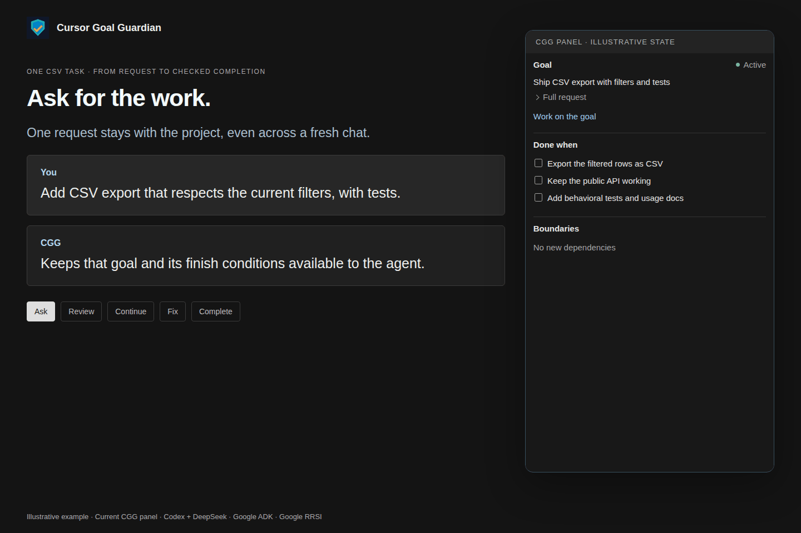

# Cursor Goal Guardian

**Help Cursor finish what you asked.**

CGG brings together goal keeping, independent review and feedback-driven learning to help Cursor finish your request, catch meaningful omissions and avoid unnecessary work.

| What CGG does | What powers it |
| --- | --- |
| **Goal loop** — remembers your goal across chats and sends the agent back with what remains. | Goal-keeping code from **[OpenAI Codex](https://github.com/openai/codex) + [DeepSeek Harness](https://github.com/deepseek-ai/deepseek-harness)**. |
| **Independent review** — checks finished work for meaningful omissions, defects and unrequested changes, then sends useful findings back. | **CGG’s project reviewer + [Google ADK](https://github.com/google/adk-python)** and its open-source evaluation toolkit. |
| **Self-improvement** — learns from your specific feedback by testing reviewer-prompt updates before adopting them. | **[Google RRSI](https://github.com/google-research/rrsi)**, with separate examples to check an update and an option to undo it. |

CGG helps a normal agent finish the work. It is not an honesty detector and does not ask the agent to prove its honesty.

[Get started](#get-started) · [See the workflow](#see-what-it-does) · [Feedback and learning](#correct-a-finding-help-future-reviews)

## See what it does

**You ask:** “Add CSV export that respects the current filters, with tests.”

Cursor adds an export and stops. The export still includes filtered-out rows. CGG finds the missing behavior and sends Cursor back to fix it and add a regression test. The updated work is checked against the original request before the goal is marked complete.

*Illustrative conversation and example data, with the current CGG panel. These visuals explain the workflow; they are not recordings of real model sessions.*

[Watch the actual Cursor panel](https://github.com/khalidsaidi/cursor-goal-guardian/releases/latest/download/cgg-cursor-panel.mp4) — see the goal, completed work and finish conditions inside Cursor.

## Get started

You need Cursor, a trusted Git project and a signed-in [Cursor CLI](https://cursor.com/docs/cli/installation) on the machine where the project runs. For WSL, install and sign in to the CLI inside WSL. CGG recognizes `agent` and the older `cursor-agent` name. Linux packages require glibc 2.39+ and OpenSSL 3, such as Ubuntu 24.04. CGG bundles its other runtimes; no separate Google Cloud account or Google model key is required.

1. Download the **latest VSIX** for your operating system and processor from [GitHub releases](https://github.com/khalidsaidi/cursor-goal-guardian/releases/latest). Choose `win32` for Windows, `darwin` for macOS or `linux` for Linux; choose `arm64` for Apple silicon or an ARM processor, otherwise `x64`. For a WSL project, use the Linux package and install it in the WSL extension host.
2. In Cursor, open the Command Palette (**Ctrl+Shift+P**, or **Cmd+Shift+P** on macOS), run **Extensions: Install from VSIX…** and select the downloaded file.
3. Open your trusted Git project. Run **Goal Guardian: Show Panel**, then click **Connect Guardian**. The goal fields are optional; you can leave them empty.
4. Click **Open MCP Settings** in the setup notification and enable **goal-guardian** for the project. In a remote workspace, open Cursor’s MCP settings manually if the button cannot open them.
5. Ask Cursor for the work as usual: “Add CSV export that respects the current filters, with tests.” That request becomes the goal.

CGG is also available on [Open VSX](https://open-vsx.org/extension/khalidsaidi/cursor-goal-guardian-extension).

## Stay with the goal

Use `/guardian` for a short briefing on the goal and remaining work. A fresh chat keeps the original goal, so you can pick up where you left off. Use `/guardian-goal` to show or change it, pause it or resume it.

The panel shows finish conditions, findings and controls. **Pause goal** stops follow-ups. **Resume goal** or **Work on the goal** opens a new chat. The agent cannot resume your pause on its own. You can also mark the work done yourself.

## Check completion

The project reviewer checks requested behavior, applicable tests/builds and affected public entry points. ADK checks the recorded work and project evidence against your request. A useful finding goes back to the agent. Valid checks can be reused while the relevant work and evidence stay unchanged.

**Complete** means the requested work passed the independent checks. **Needs attention** means a review finding remains. **Changes made** means work was delivered but independent checking is incomplete; the check record remains available under **Check details**. **Unverified** means part of goal tracking could not run. A block, pause or reached limit also remains visible. CGG does not turn incomplete verification into a checked completion.

## Correct a finding, help future reviews

Suppose a reviewer calls the requested CSV regression test “unrequested work.” Choose **Unnecessary complaint** beside that finding and explain that the test belongs to your request. Use **Useful finding** for a catch worth keeping. Explicit corrections in chat can reach the same records. If accepted work was unfinished, **This wasn't done** reopens the original goal.

Your correction helps the current review and is saved for later learning. It does not instantly replace the reviewer. With enough specific feedback, RRSI tests prompt updates against past work and separate held-out examples. CGG adopts an update only if it qualifies; otherwise it keeps the current reviewer.

Open **Goal Guardian: Command Center → Automatic learning…** and choose Off, Light or Standard. Learning yields to active work and shares a rolling workspace allowance. Feedback stays saved when learning is off. **Undo** returns to the built-in reviewer.

## Usage and privacy

Follow-ups, independent checks and learning use your Cursor plan. A headless invocation can contain several model turns, so the learning allowance is not a dollar or token cap. You control background learning from the Command Center.

CGG stores goal records, command output and review cases locally under `.cursor/goal-guardian`. Relevant records and source are sent through your Cursor account for review and learning. Treat that content as you would other material you share with Cursor.

## Support and limits

Packages are available for Windows, macOS and Linux on x64 and ARM64. Native package checks use stand-in models; real Cursor/model evidence comes from Linux/WSL. A successful package check does not establish model accuracy or desktop delivery on every platform.

CGG helps an ordinary agent finish; it is not an honesty detector. It cannot force continuation or guarantee a correct review. The project reviewer needs Git. Desktop follow-ups require Cursor’s stop hook and a trusted workspace; the tested headless CLI does not supply that hook. Cursor updates and other stop hooks can affect the loop. CGG does not protect its records against deliberate tampering.

Earlier real-model RRSI search produced useful prompt changes. Native Cursor checks cover specific corrections and use of an installed candidate. Improvement from naturally accumulated user feedback, and a fresh complete feedback-to-search-to-adoption sequence in one native Cursor run, have not been demonstrated. See the [verification guide](https://github.com/khalidsaidi/cursor-goal-guardian/blob/main/docs/verification.md) for the evidence and scope.

## Reference

CGG creates project records under `.cursor/goal-guardian`, a rule under `.cursor/rules`, and `/guardian` and `/guardian-goal` skills under `.cursor/skills`. Setup registers a user-level goal-guardian MCP entry for agent-hub chats, preserving unrelated entries. Chat tools: `get_goal`, `create_goal`, `update_goal`, `goal_command`, `guardian_change_goal`, `guardian_review_feedback`.

Use **Goal Guardian: Remove from Workspace** to remove the project integration. The extension setting `goalGuardian.statusBar.enabled` controls the status-bar item.

See the [project README](https://github.com/khalidsaidi/cursor-goal-guardian#readme) and [design](https://github.com/khalidsaidi/cursor-goal-guardian/blob/main/docs/goal-design.md). Upstream contributions and licenses are recorded in NOTICE: [OpenAI Codex](https://github.com/openai/codex), [DeepSeek Harness](https://github.com/deepseek-ai/deepseek-harness), [Google ADK](https://github.com/google/adk-python) and [Google Research RRSI](https://github.com/google-research/rrsi).
